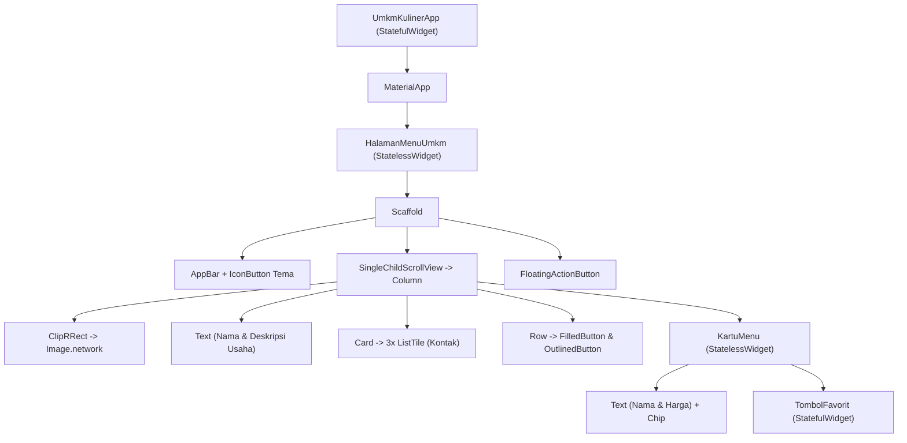

# Tugas Rutin 5 — Halaman Menu UMKM Kuliner Medan

- Nama  :   Angelina S. Saragih
- NIM   :   4243250049
- Kelas :   PSIK 24C

## Tangkapan Layar Aplikasi

Mode Terang

Mode Gelap

## Diagram Widget Tree

## Penjelasan Arsitektur Flutter & Pemilihan Widget
Di balik layar, Flutter merender tampilan menggunakan tiga struktur pohon yang saling terhubung[cite: 30, 31]. **Widget tree** berisi konfigurasi tampilan yang bersifat *immutable* dan dibangun ulang setiap kali method `build()` dipanggil[cite: 30, 31]. **Element tree** berperan sebagai jembatan yang bertahan lebih lama di memori, menyimpan objek `State`, dan menjadi `BuildContext` untuk mencocokkan perubahan antara widget lama dengan widget baru[cite: 31]. Selanjutnya, **RenderObject tree** bertugas menghitung ukuran, mengatur posisi (*layout*), serta menggambar piksel (*paint*) ke layar[cite: 31].

Pada aplikasi ini, `HalamanMenuUmkm` dan `KartuMenu` dibuat sebagai **StatelessWidget** karena informasi profil usaha, kontak, serta daftar menu bersifat tetap dan hanya menampilkan data dari parameter[cite: 33, 40]. Sebaliknya, **StatefulWidget** hanya dipakai pada bagian kecil yang memang berubah akibat interaksi pengguna, yaitu `UmkmKulinerApp` untuk menyimpan status tema terang/gelap dan `TombolFavorit` untuk mengubah status ikon hati (`_favorit`)[cite: 34, 40]. Pemisahan ini membuat pemanggilan `setState()` cukup membangun ulang tombol yang ditekan tanpa merender ulang seluruh halaman menu[cite: 31, 38].

## Pernyataan Penggunaan AI
Dalam pengerjaan tugas ini, AI digunakan sebagai alat bantu referensi untuk menyusun kerangka awal struktur kode, penulisan skenario *widget test*, serta pengecekan kendala saat menjalankan Flutter DevTools. Seluruh konten data menu, penyesuaian logika kode, pengujian dengan `flutter analyze` dan `flutter test`, serta pengambilan tangkapan layar dilakukan dan diverifikasi secara mandiri.